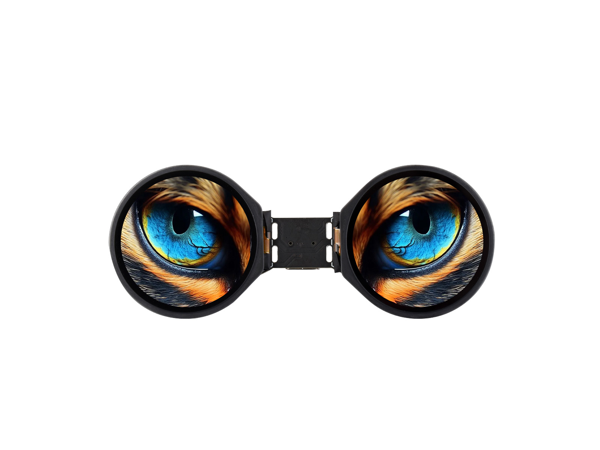

  <h1>ESP32-S3-DualEye-Touch-LCD-1.28</h1>
  
<strong>ESP32-S3 dual 1.28-inch circular LCD touch development board</strong>

  
<strong>English</strong> | <a href="README_ZH.md">简体中文</a>

  

    
    
    
  

  

    <a href="https://www.waveshare.net/shop/ESP32-S3-DualEye-Touch-LCD-1.28.htm">🌐 Product</a> &middot;
    <a href="https://github.com/2823700739-sudo/ESP32-S3-DualEye-Touch-LCD-1.28/releases/latest">📦 Firmware</a> &middot;
    <a href="examples/esp-idf/">🧩 ESP-IDF</a> &middot;
    <a href="examples/arduino/examples/">🔧 Arduino</a> &middot;
    <a href="hardware/">📚 Documentation</a>
  

  

---

## ✨ Overview

Dual 240 × 240 LCDs, touch input and onboard audio support LVGL interfaces and interactive displays. This repository contains examples for both the touch and non-touch variants; choose the matching board in each example README.

| Feature | Device / interface |
| --- | --- |
| MCU | ESP32-S3R8 |
| Memory | 16 MB Flash, 8 MB PSRAM |
| Display | 2 × 1.28-inch, 240 × 240, SPI, GC9A01 |
| Touch | CST816S, I2C (touch variant) |
| Audio | ES8311 codec, ES7210 microphone ADC |

## 📦 Quick Start

Existing demo images are listed in [`firmware`](firmware/). When example packages are published, use the
[latest release](https://github.com/2823700739-sudo/ESP32-S3-DualEye-Touch-LCD-1.28/releases/latest) as follows:

1. Download the `*-combined.zip` package for the example and framework version you need.
2. Extract the archive and install esptool with `python -m pip install esptool`.
3. Connect the board over USB.
4. Run `flash_combined.bat COMx` on Windows or `./flash_combined.sh /dev/ttyACM0` on Linux.
5. Reset the board if it does not restart automatically.

## 🧪 Examples

### ESP-IDF

| Example | Main feature |
| --- | --- |
| [LCD_01_Text_Number](examples/esp-idf/LCD_01_Text_Number/) | Display text and changing numbers on both circular screens. |
| [LCD_02_Shapes_on_Circular](examples/esp-idf/LCD_02_Shapes_on_Circular/) | Draw geometric shapes on the circular screens with LVGL. |
| [LCD_03_Animated_Eye1](examples/esp-idf/LCD_03_Animated_Eye1/) | Animate a pair of eyes on the two LCDs. |
| [LCD_04_SD_gif_show](examples/esp-idf/LCD_04_SD_gif_show/) | Load GIF animations from the microSD card and switch them with BOOT. |
| [LCD_05_Clock](examples/esp-idf/LCD_05_Clock/) | Draw analog clock faces and digital time on both screens. |
| [LCD_06_Music_Player](examples/esp-idf/LCD_06_Music_Player/) | Show board information and an SD music player with microphone support. |

### Arduino

| Example | Main feature |
| --- | --- |
| [LCD_01_LCD_Driver](examples/arduino/examples/LCD_01_LCD_Driver/) | Initialize both LCDs and display LVGL text and numbers. |
| [LCD_02_Mic_test](examples/arduino/examples/LCD_02_Mic_test/) | Use BOOT to play built-in audio and record microphone audio for playback. |
| [LCD_03_SD_test](examples/arduino/examples/LCD_03_SD_test/) | Read BMP images from microSD and display them on the two LCDs. |
| [LCD_04_LVGL_Arduino](examples/arduino/examples/LCD_04_LVGL_Arduino/) | Run the LVGL board information and peripheral demonstration. |
| [Touch_01_LCD_Driver](examples/arduino/examples/Touch_01_LCD_Driver/) | Initialize both LCDs and display LVGL text and numbers. |
| [Touch_02_Drawing_board](examples/arduino/examples/Touch_02_Drawing_board/) | Draw on the touch screens and clear the canvas with BOOT. |
| [Touch_03_Mic_test](examples/arduino/examples/Touch_03_Mic_test/) | Use BOOT to play built-in audio and record microphone audio for playback. |
| [Touch_04_SD_test](examples/arduino/examples/Touch_04_SD_test/) | Read BMP images from microSD and display them on the two LCDs. |
| [Touch_05_LVGL_Arduino](examples/arduino/examples/Touch_05_LVGL_Arduino/) | Run the LVGL board information and peripheral demonstration. |
| [Touch_LVGL_Arduino_Touch-Half-A](examples/arduino/examples/Touch_LVGL_Arduino_Touch-Half-A/) | Run the LVGL interface and audio functions on the detached A main board. |
| [Touch_LVGL_Arduino_Touch-Half-B](examples/arduino/examples/Touch_LVGL_Arduino_Touch-Half-B/) | Run the LVGL board information interface on the detached B display board. |

Libraries used by the sketches are bundled in [`examples/arduino/libraries`](examples/arduino/libraries/).

## 🛠️ Development Environment

| Framework | Version | Examples |
| --- | --- | ---: |
| ESP-IDF | `v5.5.1` | 6 |
| Arduino-ESP32 | `3.2.0` | 11 |

## 📚 Resources

- [Schematic](hardware/schematic/ESP32-S3-DualEye-Touch-LCD-1.28-Schematic.pdf)
- [Product page](https://www.waveshare.net/shop/ESP32-S3-DualEye-Touch-LCD-1.28.htm)
- [Wiki](https://docs.waveshare.net/ESP32-S3-DualEye-Touch-LCD-1.28/)

## 🤝 Support

- Example or repository problem: [open an issue](https://github.com/2823700739-sudo/ESP32-S3-DualEye-Touch-LCD-1.28/issues/new/choose).
- Product usage, hardware or order questions: [Waveshare support](https://service.waveshare.com/).

## 📄 License

Apache License 2.0. See [LICENSE](LICENSE).
