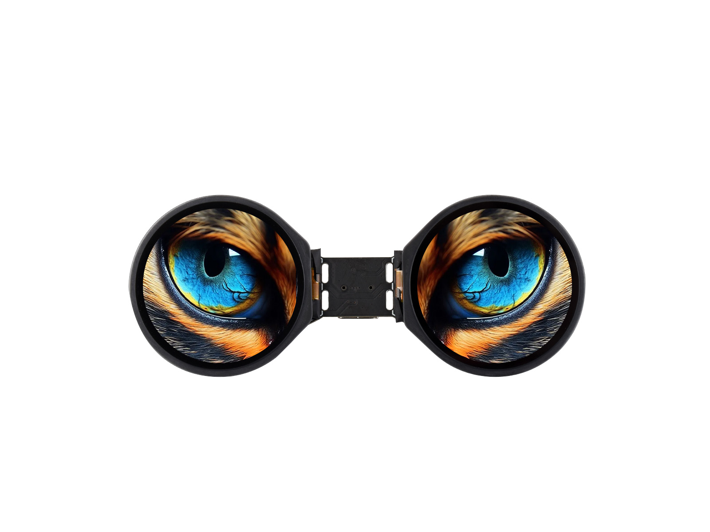

  <h1>ESP32-S3-DualEye-Touch-LCD-1.28</h1>
  
<strong>ESP32-S3 双 1.28 英寸圆形 LCD 触摸开发板</strong>

  
<a href="README.md">English</a> | <strong>简体中文</strong>

  

    
    
    
  

  

    <a href="https://www.waveshare.net/shop/ESP32-S3-DualEye-Touch-LCD-1.28.htm">🌐 产品</a> &middot;
    <a href="https://github.com/2823700739-sudo/ESP32-S3-DualEye-Touch-LCD-1.28/releases/latest">📦 固件</a> &middot;
    <a href="examples/esp-idf/">🧩 ESP-IDF</a> &middot;
    <a href="examples/arduino/examples/">🔧 Arduino</a> &middot;
    <a href="hardware/">📚 文档</a>
  

  

---

## ✨ 概述

开发板集成双 240 × 240 LCD、触摸和板载音频，适用于 LVGL 界面与交互显示。本仓库同时保留触摸版和非触摸版示例，请按各示例 README 选择对应开发板。

| 功能 | 器件或接口 |
| --- | --- |
| MCU | ESP32-S3R8 |
| 存储器 | 16 MB Flash，8 MB PSRAM |
| 显示 | 2 × 1.28 英寸，240 × 240，SPI，GC9A01 |
| 触摸 | CST816S，I2C（触摸版） |
| 音频 | ES8311 编解码器、ES7210 麦克风 ADC |

## 📦 快速开始

已有演示镜像见 [`firmware`](firmware/README_ZH.md)。发布示例固件包后，可按以下步骤使用[最新版本](https://github.com/2823700739-sudo/ESP32-S3-DualEye-Touch-LCD-1.28/releases/latest)：

1. 下载所需示例和框架版本对应的 `*-combined.zip`。
2. 解压后通过 `python -m pip install esptool` 安装 esptool。
3. 通过 USB 连接开发板。
4. Windows 运行 `flash_combined.bat COMx`，Linux 运行 `./flash_combined.sh /dev/ttyACM0`。
5. 如果开发板未自动重启，请手动复位。

## 🧪 示例

### ESP-IDF

| 示例 | 主要功能 |
| --- | --- |
| [LCD_01_Text_Number](examples/esp-idf/LCD_01_Text_Number/README_ZH.md) | 在两块圆屏上显示文字和变化的数字。 |
| [LCD_02_Shapes_on_Circular](examples/esp-idf/LCD_02_Shapes_on_Circular/README_ZH.md) | 使用 LVGL 在圆屏上绘制几何图形。 |
| [LCD_03_Animated_Eye1](examples/esp-idf/LCD_03_Animated_Eye1/README_ZH.md) | 在两块 LCD 上显示眼睛动画。 |
| [LCD_04_SD_gif_show](examples/esp-idf/LCD_04_SD_gif_show/README_ZH.md) | 从 microSD 卡读取 GIF 动画，使用 BOOT 按键切换。 |
| [LCD_05_Clock](examples/esp-idf/LCD_05_Clock/README_ZH.md) | 在两块屏幕上绘制模拟表盘和数字时间。 |
| [LCD_06_Music_Player](examples/esp-idf/LCD_06_Music_Player/README_ZH.md) | 显示板载信息，并提供 SD 音乐播放器和麦克风功能。 |

### Arduino

| 示例 | 主要功能 |
| --- | --- |
| [LCD_01_LCD_Driver](examples/arduino/examples/LCD_01_LCD_Driver/README_ZH.md) | 初始化双 LCD 并显示 LVGL 文字和数字。 |
| [LCD_02_Mic_test](examples/arduino/examples/LCD_02_Mic_test/README_ZH.md) | 通过 BOOT 播放内置音频，并录制麦克风声音后回放。 |
| [LCD_03_SD_test](examples/arduino/examples/LCD_03_SD_test/README_ZH.md) | 读取 microSD 卡中的 BMP 图片并在双 LCD 上显示。 |
| [LCD_04_LVGL_Arduino](examples/arduino/examples/LCD_04_LVGL_Arduino/README_ZH.md) | 运行 LVGL 板载信息和外设演示界面。 |
| [Touch_01_LCD_Driver](examples/arduino/examples/Touch_01_LCD_Driver/README_ZH.md) | 初始化双 LCD 并显示 LVGL 文字和数字。 |
| [Touch_02_Drawing_board](examples/arduino/examples/Touch_02_Drawing_board/README_ZH.md) | 在触摸屏上绘图，并通过 BOOT 清除画布。 |
| [Touch_03_Mic_test](examples/arduino/examples/Touch_03_Mic_test/README_ZH.md) | 通过 BOOT 播放内置音频，并录制麦克风声音后回放。 |
| [Touch_04_SD_test](examples/arduino/examples/Touch_04_SD_test/README_ZH.md) | 读取 microSD 卡中的 BMP 图片并在双 LCD 上显示。 |
| [Touch_05_LVGL_Arduino](examples/arduino/examples/Touch_05_LVGL_Arduino/README_ZH.md) | 运行 LVGL 板载信息和外设演示界面。 |
| [Touch_LVGL_Arduino_Touch-Half-A](examples/arduino/examples/Touch_LVGL_Arduino_Touch-Half-A/README_ZH.md) | 在分板后的 A 主控板上运行 LVGL 界面和音频功能。 |
| [Touch_LVGL_Arduino_Touch-Half-B](examples/arduino/examples/Touch_LVGL_Arduino_Touch-Half-B/README_ZH.md) | 在分板后的 B 显示板上运行 LVGL 板载信息界面。 |

草图使用的库随仓库提供，位于 [`examples/arduino/libraries`](examples/arduino/libraries/)。

## 🛠️ 开发环境

| 开发框架 | 版本 | 示例数 |
| --- | --- | ---: |
| ESP-IDF | `v5.5.1` | 6 |
| Arduino-ESP32 | `3.2.0` | 11 |

## 📚 资料

- [原理图](hardware/schematic/ESP32-S3-DualEye-Touch-LCD-1.28-Schematic.pdf)
- [产品页](https://www.waveshare.net/shop/ESP32-S3-DualEye-Touch-LCD-1.28.htm)
- [Wiki](https://docs.waveshare.net/ESP32-S3-DualEye-Touch-LCD-1.28/)

## 🤝 支持

- 产品使用、硬件或订单问题：[微雪技术支持](https://docs.waveshare.net/ESP32-S3-DualEye-Touch-LCD-1.28/Technical-Support/)。

## 📄 许可证

Apache License 2.0，详见 [LICENSE](LICENSE)。
